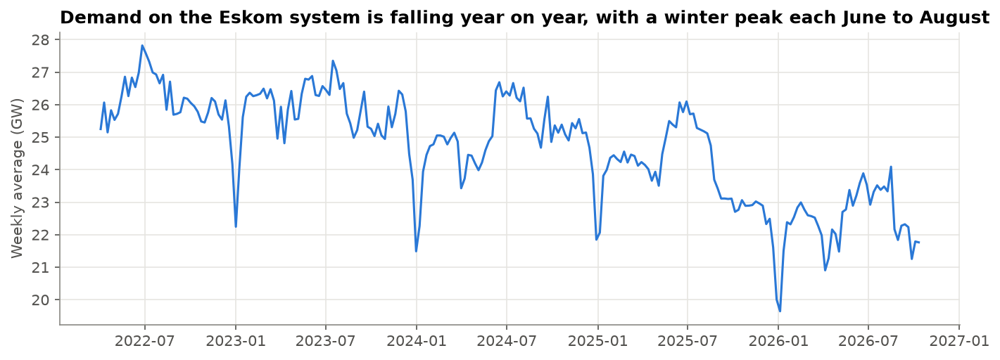
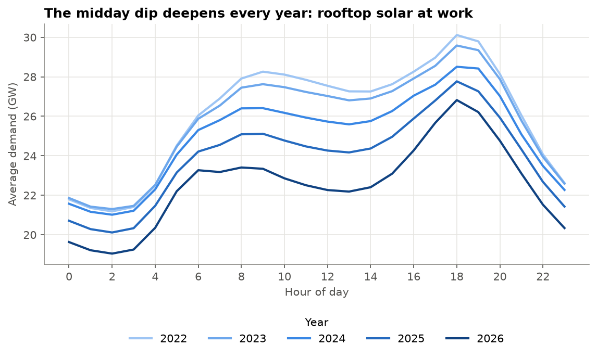
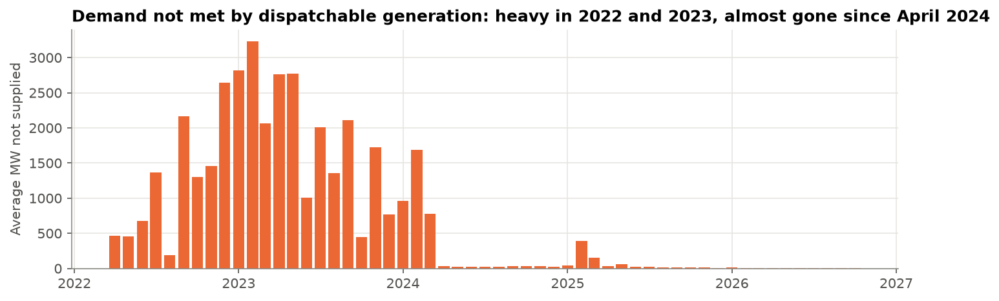
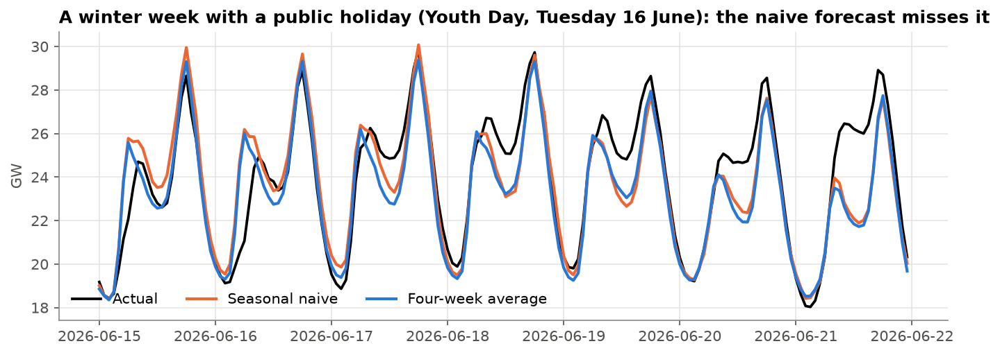
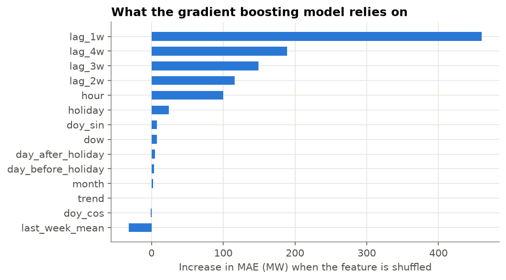
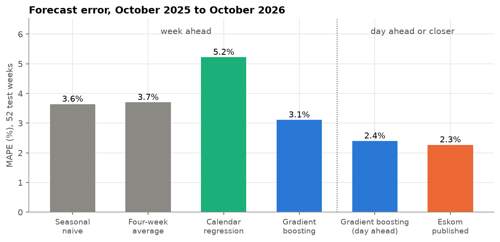
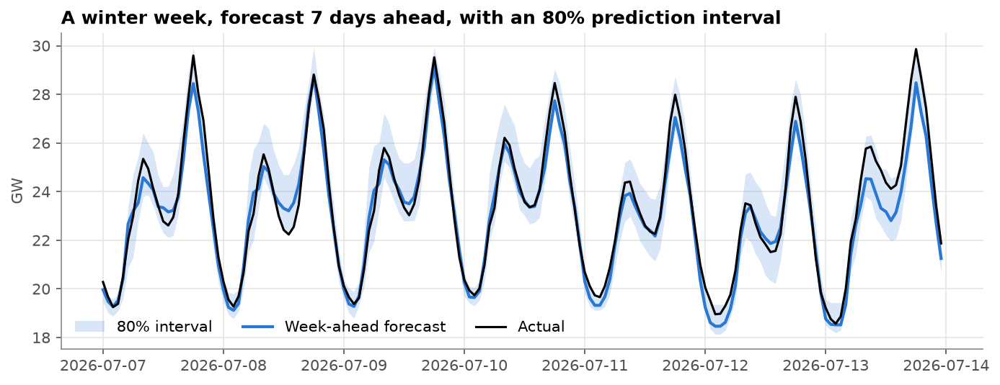

# Eskom Demand Forecasting: How Much Electricity Will South Africa Need Next Week?

## 1. Business problem

**Why the forecast matters.** Eskom has to have enough generation ready to meet demand every hour. When demand turns out higher than planned, the control room has two expensive options: run the diesel-fired open-cycle gas turbines (OCGTs), which cost far more per unit of electricity than coal, or reduce load (load shedding). When demand turns out lower than planned, coal units are kept running or on standby for nothing. A better forecast means less diesel, fewer emergencies and lower cost.

**Question.** How much electricity will South Africa need next week, hour by hour, and can a simple, transparent model match or beat Eskom's own published forecast?

**Forecast set-up**

- **Target:** `RSA Contracted Demand`, the hourly demand that Eskom has to supply through all the resources it has contracts with (its own plants and contracted independent power producers).
- **Horizon:** 7 days ahead, hourly: every week, forecast the next 168 hours.
- **Error metrics:** **MAPE** (mean absolute percentage error), easy for managers to read, and **MAE in MW**, the size of the error the control room has to cover with reserves.
- **Validation:** walk-forward over a full year, so every season is tested and nothing from the future leaks into training.
- **Benchmarks:** two simple baselines, and Eskom's own published forecast for the same hours.

**Why this is the South African flagship project.** It uses genuine South African data, published by Eskom, on a problem every South African has lived through.

## 2. Data

**Source:** [Eskom Data Portal](https://www.eskom.co.za/dataportal/). The public pages show only the last week, so the full history was requested through the [data request form](https://www.eskom.co.za/dataportal/data-request-form/), which emails a download link. The file covers 1 April 2022 (the earliest date available) to 31 March 2027: **actual values up to 6 October 2026** (39,600 hours, 4.5 years, no gaps) and Eskom's forecasts after that.

The raw file is **not committed** to this repository (Eskom's terms apply). To run the notebooks, request the same data and save the CSV in `data/raw/`.

| Column | Meaning (MW, hourly average) |
|---|---|
| `RSA Contracted Demand` | Demand to be supplied by all resources Eskom has contracts with. **The target.** |
| `Residual Demand` | Demand to be supplied by resources Eskom National Control can dispatch: contracted demand minus wind, solar and other renewables |
| `RSA Contracted Forecast`, `Residual Forecast` | Eskom's own forecasts of the two demands |
| `Dispatchable Generation` | What the dispatchable fleet actually generated |
| `Wind`, `PV`, `CSP`, `Other RE`, `Total RE` | Contracted renewable generation (photovoltaic, concentrated solar, small hydro, biomass, landfill gas) |
| `... Installed Capacity` | Installed renewable capacity by type |

Definitions from the [Eskom Data Portal glossary](https://www.eskom.co.za/dataportal/glossary/). Two consistency checks pass: contracted minus residual demand equals renewable generation (median difference 0 MW), and residual demand exceeds dispatchable generation only in hours of load shedding (37% of hours, almost all in 2022 and 2023). The demand target therefore appears to include demand that was cut off, so it is consistent before and after load shedding.

## 3. What the data shows

1. **Demand on the Eskom system is falling.** Average contracted demand went from about 26.1 GW in 2022 to about 22.5 GW in 2026, roughly 14% lower. A large part of this is rooftop solar behind the meter, which Eskom never sees as demand, plus customers moving to their own generation after years of load shedding. The model has to cope with a level that keeps moving down.
2. **Strong cycles:** two daily peaks (morning and evening), lower weekends (Sundays about 1.5 GW below weekdays during the day), and a winter peak every June to August.

3. **The midday dip deepens every year.** Since 2022 midday demand has fallen far faster than the evening peak: the gap between 7pm and noon grew from 2.3 GW in 2022 to 4.0 GW in 2026. Solar panels produce at midday and nothing at 7pm. This is South Africa's version of the "duck curve", and it makes the winter evening peak the critical hour.
4. **Public holidays** cut daily demand by about 5%, more during working hours.

5. **Load shedding is visible** in the gap between residual demand and dispatchable generation: about 1,900 MW on average in 2023, and close to zero (about 36 MW) since April 2024. Nobody knows next week's load shedding in advance, so the gap is not used as a feature.

## 4. Baselines

Test period: the **52 weeks from 7 October 2025 to 5 October 2026**. Each week's 168 hours are forecast using only data from before that week.

| Baseline | How it works | MAPE | MAE |
|---|---|---|---|
| Seasonal naive | Each hour = the same hour last week | **3.64%** | 818 MW |
| Four-week average | Each hour = average of the same hour over the last 4 weeks | 3.70% | 826 MW |

"Same as last week" is already within about 4%, because the daily and weekly cycles repeat so strongly. Its weakness is predictable: it copies last week's holidays into this week and misses this week's (above, Youth Day on Tuesday 16 June 2026). This is the bar every model has to clear.

## 5. Models

**Features, all known at the time of the forecast:** hour, day of week, month, a smooth day-of-year cycle, South African public holidays (including Sunday-to-Monday moves), the days before and after a holiday, a time trend, and demand at the same hour 1, 2, 3 and 4 weeks earlier. A one-week lag is always known for a forecast up to one week ahead, so nothing leaks.

**Walk-forward validation:** each of the 52 weeks is forecast by a model trained only on data before it; models are retrained every 4 weeks.

| Model (week ahead) | MAPE | MAE | Bias |
|---|---|---|---|
| Seasonal naive (baseline) | 3.64% | 818 MW | +15 MW |
| Calendar regression (ridge, hour x day-type and hour x month) | 5.22% | 1,161 MW | **+887 MW** |
| **Gradient boosting (calendar + lagged demand)** | **3.11%** | **704 MW** | +31 MW |

- **The calendar regression loses even to the baseline.** Its bias shows why: it over-forecasts by almost 900 MW, because a straight-line trend learned from four years cannot keep up with a decline that is speeding up. Knowing the calendar is not enough without knowing the recent level.
- **Gradient boosting** combines both: the calendar and holidays, plus recent demand to set the level. It is **about 15% more accurate than "same as last week"**.

## 6. Evaluation

| Forecast | MAPE | MAE |
|---|---|---|
| Seasonal naive, week ahead | 3.64% | 818 MW |
| Gradient boosting, week ahead | 3.11% | 704 MW |
| Gradient boosting, **day ahead** | **2.40%** | **540 MW** |
| **Eskom published forecast** | **2.27%** | **512 MW** |

**A fair comparison with Eskom.** The file does not say when Eskom's forecast values were made. Their small, steady errors suggest they are updated close to the hour, using yesterday's demand, the latest weather forecast and operators' knowledge. So I also ran a **day-ahead** version of the model, which adds demand 24 and 48 hours earlier. At that horizon the model comes within about 0.1 percentage points of Eskom's forecast, **without any weather data**.

**Prediction intervals.** Quantile gradient boosting gives a 10th to 90th percentile band. Raw, it covered only 60% of test hours instead of 80%. Quantile models are typically too narrow on new data, so the band was **calibrated** on the 26 weeks before the test year (conformalized quantile regression), widening each side by 201 MW. On the test year it then covered **74%** of hours: much better, but still a little narrow, because the test year was more volatile than the calibration period.

